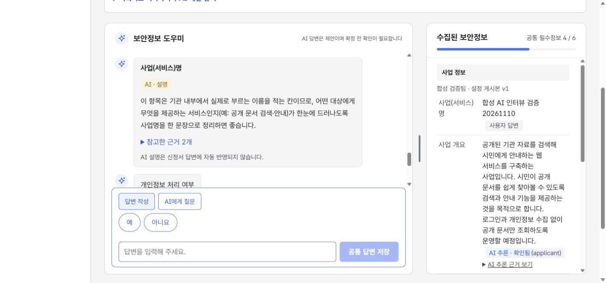
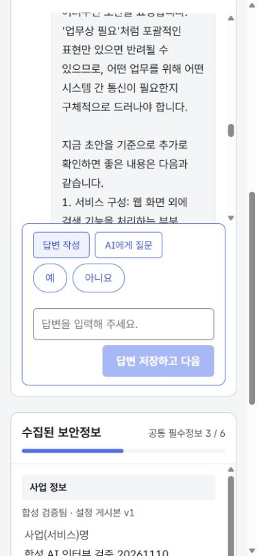
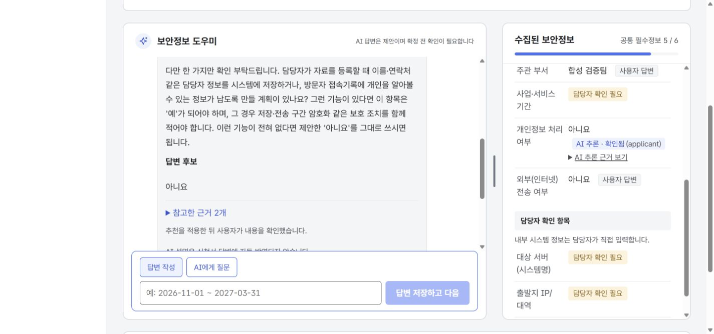

# 게시본 기반 신청자 AI 인터뷰

기준: FUNCTIONAL_SPEC v1.11, design v3.1, prototype-soo `563dd7e76aeeb4fe63f010bec9cd1f9bac16d5dc`와 MERGE_NOTES.md. 실제 연결 환경은 Docker Front 3001 → Back 8081 → PostgreSQL이다.

## 사용자 흐름

기관 관리자가 게시한 공통 질문의 제목·작성 안내·입력 형식을 사용한다. LONG_TEXT는 여러 줄 입력, BOOLEAN은 예·아니요 선택, NUMBER는 숫자 입력, DATE_RANGE는 기간 안내를 제공한다. `왜 필요한가요?`는 해당 사업 건에 고정된 게시본과 연결된 공개자료를 조회한다.

AI 추천은 대화창에서 설명·답변 후보·근거를 보여 준다. 사용자가 `추천을 미확정 답변으로 적용`을 누르면 공식 답변에 AI 추론으로 저장되며, 내용을 확인하는 버튼을 누른 뒤에만 완료로 계산한다. 하단 입력창은 `답변 작성`과 `AI에게 질문`으로 전환하며 두 초안을 각각 보존한다. 자유 질문은 대화 이력에 남으며 답변을 자동 저장하거나 다음 질문으로 이동하지 않는다. AI 생성 중 입력이 바뀌면 오래된 후보를 적용할 수 없다. 추천 적용 중에는 공식 답변 편집과 이동을 잠시 막아 입력이 사라지지 않게 한다.

`나중에 입력`은 저장하지 않는다. `잘 모르겠어요 · 담당자 확인 요청`은 기존 staff-check API로 확인 필요를 표시한다. 실제 협의는 서류별 상세에서 요청한다. 미완료 필수 항목이 남았을 때 완료했다고 안내하지 않는다. 담당자 항목은 직접 입력·할당·검토 영역으로 남긴다.

파일 없는 사업 개요 저장을 AI 분석이라고 표시하지 않는다. 항목별 추천은 저장된 개요와 현재 입력을 참고하므로 파일 없이도 사용할 수 있다.

## 검증

- `npm run format && npm run check`: 25개 파일, 231개 테스트 통과. 타입·린트·문서 버전 검사 포함.
- Docker에서 Front·Back 프로덕션 빌드 및 기동 성공, 기존 DB·업로드·AI 설정 보존.
- `npm run test:connection`: 프록시·인증·CSRF·세션 종료 통과.
- 합성 계정과 별도 합성 사업 건으로 live AI 추천→미확정 적용→직접 확인, 자유 질문, 도움말, 담당자 확인 요청, 미완료 3개 표시를 확인했다. 원래 대상 사업 건의 답변은 수정하지 않았다.
- 384px CSS 너비에서 페이지·질문·AI 입력 영역 가로 넘침 없음, 키보드로 나중에 입력과 다음 항목 이동 확인.
- Back: 전체 147개 검사 중 실패 0, 환경 선택 검사 2개 제외.

## 대화 중심 입력창 개선 — Front #26

사용자 요청에 따라 `qcard interview-question`에는 입력 방식 전환, 답변 선택 버튼, 입력란, 저장·질문 전송만 남긴다. 질문 안내·도움말·추천·AI 응답·오류는 `msgs conversation-body`에서 보여 준다. 근거는 AI 메시지 안에서 펼쳐 볼 수 있고, 같은 응답을 입력 카드에 중복 표시하지 않는다.

대화 영역의 최소 높이를 24rem으로 늘리고 입력 카드의 최대 높이를 38%로 줄였다. 저장하면 다음 질문이 보이고, 긴 AI 응답은 시작부터 읽도록 대화창 내부만 이동한다. 입력 중·저장 실패에는 읽던 위치를 유지하고, AI 요청 실패 시 오류 안내로 이동한다.

추가 검증(2026-11-10):

- `npm run format && npm run check`: 25개 파일, 233개 테스트 통과. 모드별 초안 보존, 응답 중복 방지, 명시적 적용, 오래된 추천 보호, 입력·실패·저장·응답 스크롤 포함.
- Front Docker 프로덕션 빌드 및 3001 재기동, `npm run test:connection` 통과. Back API·DB 스키마 변경 없음.
- 3001의 원래 사업 건은 읽기 전용으로 화면 배치만 확인했다. 별도 합성 계정 세션에서 기존 AI 이력 조회, live AI 질문→대화 응답, 질문 초안 보존, 선택형 답변 저장→다음 질문·완료 개수 반영을 확인했다.
- 데스크톱 1440px 및 좁은 화면 390px에서 가로 넘침 없음, 선택 버튼에서 입력란으로 키보드 이동 확인. 전체 화면 낭독기·실제 휴대폰 검증은 수행하지 않았다.
- 디자인 기준 커밋과 업무 규정 버전은 문서 상단과 동일하다. 대화와 입력의 분리는 이번 사용자 요청을 반영했다.

## 실제 사용자 흐름 재검증과 이어서 확인하기 — Front #28

미확정 추천을 적용한 뒤 새로고침하면 첫 질문으로 돌아가던 문제를 수정했다. 탭에 보관한 입력이 있으면 그 위치를 유지하고, 새로 열 때는 저장된 미확정 AI 답변 → 남은 미완료 항목 순서로 이어간다. 모두 확인한 경우 완료 안내를 표시한다. 다른 항목을 보고 있을 때는 적용된 추천 메시지의 `적용한 답변 확인하기`로 돌아갈 수 있다. 읽기 전용 사용자에게는 이동·적용 버튼을 제공하지 않는다. 답변 후보가 없는 추천 응답은 `추가 정보 필요`로 표시한다.

2026-11-10 Docker 실제 연결 환경에서 확인한 결과:

| 흐름 | 확인 결과 |
| --- | --- |
| 원래 대상 사업 건의 AI 질문·추천 요청 | 실제 AI 응답을 대화창에 표시. 정보가 부족한 추천은 추가 질문만 반환하고 공식 답변을 생성하지 않음 |
| 별도 합성 사업 건 생성 | 사용자 요청에 따라 실제 답변을 임의로 채우지 않고 합성 사업 건 10에서 저장 흐름 검증 |
| 추천 후 직접 입력 변경 | 오래된 추천 적용 버튼 비활성화. 요청 당시 입력으로 되돌린 뒤 적용 가능 |
| 추천을 미확정으로 적용 | 개인정보 처리 여부 `아니요`, 출처 `AI 추론 · 미확정`. 완료 개수는 3/6 유지 |
| 새로고침·다른 질문 이동 | 미확정 항목으로 재개. 대화의 확인 버튼으로 해당 답변 복귀 |
| AI 답변 확인하고 다음 | AI 출처·근거를 유지하며 `확인됨`으로 저장, 완료 4/6 |
| 선택형 답변 저장 | 외부 전송 여부 `아니요`를 `사용자 답변`으로 저장, 완료 5/6. 미정인 기간은 완료로 계산하지 않음 |
| 저장 후 새로고침 | 두 저장 값과 출처·확인 상태 유지. 남은 기간 항목으로 재개, AI 메시지 중복 없음 |

원래 대상 사업 건에는 AI 대화 이력만 추가했고 신청서 답변은 변경하지 않았다. 개인정보 처리 여부는 계속 미확정이다. 합성 계정은 별도 세션에서 검증 후 로그아웃했다. 브라우저 오류 로그는 없었다.

검증: `npm run format && npm run check`(25개 파일, 237개 테스트), Docker Front 프로덕션 빌드·기동, `npm run test:connection` 통과. 기존 완료 자료를 다시 작성하는 회귀 검사는 사용자가 `공통 질문 다시 보기`를 누르는 흐름으로 명시했다. API·DB 계약 변경은 없다.

## 범위

신청자 공통 CASE 질문을 지원한다. 기관 비공개 자산을 조사하거나 서버·IP·포트를 생성·할당하지 않는다. 공개 지식이 없는 질문은 연결된 공개자료가 없음을 표시한다. AI 설명과 추천은 실제 모델 결과이지만 자료의 정확성 및 사업 사실은 사용자가 확인해야 한다. 모의 모드는 합성 결과임을 표시한다.

Back 계약: `b2f232bcd2c78d24db43c03407c3867894bfb7ee`, [Back PR #2](https://github.com/team-khfc/Security-Advisor-Back/pull/2). 이슈: [Front #24](https://github.com/team-khfc/Security-Advisor-Front/issues/24).
