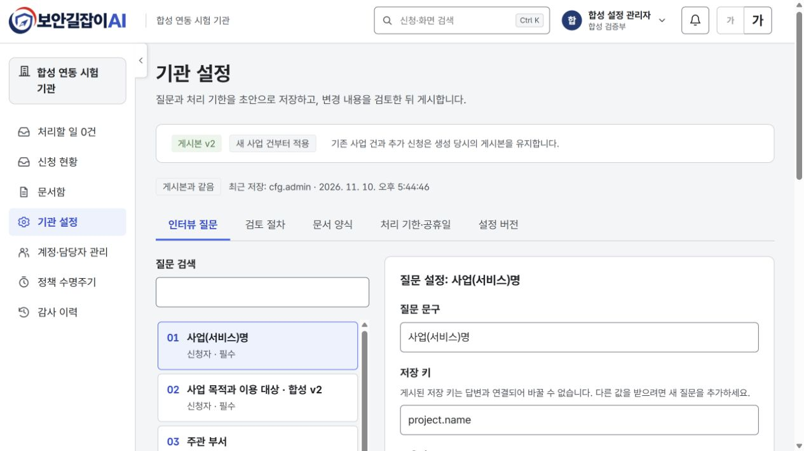
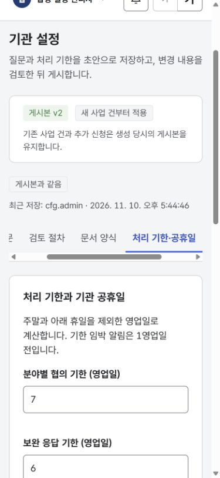

# 기관 설정 편집·게시와 버전 유지 검증

검증일: 2026-11-10. Front 이슈 #50, Back 이슈 team-khfc/Security-Advisor-Back#17.

디자인 기준: prototype-soo 기본 브랜치 `563dd7e76aeeb4fe63f010bec9cd1f9bac16d5dc`의 설정 화면·공통 토큰·MERGE_NOTES. 질문 목록과 편집 영역, 설정 탭을 유지하고 실제 저장·비교·게시와 좁은 화면 처리를 연결했다.

## 사용자 흐름

기관 관리자만 `/settings`에서 질문과 기한 정책을 편집할 수 있다. 질문 문구·도움말, 추가 질문의 형식·작성 역할·범위·적용 서류·필수 여부, 협의·보완 응답·최종 확정 기한과 공휴일을 변경한다. 기본 질문의 저장 키·형식·역할·범위·필수 계약은 잠근다.

1. **설정 초안 저장**: 모든 탭의 입력을 검사한다. 잘못된 키·중복 키·빈 문구·범위를 벗어난 기한·잘못된 날짜는 저장하지 않는다. 초안 저장만으로 신청 업무가 바뀌지 않는다.
2. **변경 검토·게시**: 저장된 초안과 게시본의 차이 및 메모를 확인하고 새 버전을 게시한다. 저장하지 않은 입력이나 변경 없는 초안은 게시할 수 없다.
3. **설정 버전**: 서버 페이지로 게시자·시각·메모를 조회한다. 내용 보기에서 당시 질문·기한·변경 내용을 읽는다. 과거 게시본은 수정하지 않는다.
4. **동시 수정**: 다른 관리자가 먼저 저장하면 409를 안내하고 내 입력을 보존한다. 최신본과 나란히 비교한 뒤 명시적으로 교체한다. 비교 창을 닫거나 Escape를 눌러도 입력은 남는다.

기한은 1~365 정수 영업일, 공휴일은 2000~2100년 최대 366개, 임박 알림은 1영업일 전이다. 질문은 최대 200개다. 저장되지 않은 편집은 현재 화면 메모리와 새로고침 경고로 보호하며 영구 자동 저장을 보장하지 않는다. 문서 양식 파일과 검토 단계 편집은 제공하지 않는다.

## 합성 Docker 실제 화면 검증

독립 검증 환경: Front `http://localhost:3011`, Back 8091, 프로젝트 `securityadvisor-configuration-qa`. v1·v2와 합성 관리자·신청자만 사용했다. 외부 AI 호출과 장비 변경은 없다.

| 검증 | 결과 |
|---|---|
| v1 사업 생성 → 질문·기한 저장 → v2 게시 | 기존 사업의 문구·질문·기한 유지 |
| v2 질문 문구·도움말 수정, 선택 질문 추가, 기한 7/6/8일과 11월 11일 공휴일 추가 | 초안 저장·비교 후 게시 성공 |
| 잘못된 키·0일 입력 | 화면 검증으로 저장 차단 |
| 두 편집 화면에서 순차 저장 | 뒤늦은 저장 409, 내 입력 유지·최신본 명시적 교체 |
| v1·v2 내용 보기 및 게시 이력 페이지 API | 게시 당시 내용과 변경 메모 보존 |
| v2 신규 사업·질문 답변 저장 | 새 문구와 추가 질문 표시, 답변 저장 성공 |
| v2 게시 뒤 기존 사업에 추가 신청 | v1 게시본·기한 유지 |
| 390×844 화면 | 페이지·대화상자 가로 넘침 없음 |
| 키보드 | 탭 화살표/Home/End, 대화상자 Tab 순환, 질문 상세 summary 열기, Escape 닫기와 원래 버튼 포커스 복귀 |

합성 기존 사업 1의 신청 1과 게시 후 추가 신청 3은 협의 기한 **2026-11-17**, 신규 사업 2의 신청 2는 **2026-11-20**으로 실제 상세 화면과 API에서 확인했다. API 검증은 버전·기한 10개, 관리자 이외 세 역할 차단 12개, 잘못된 기한 4개 및 초안 보존·페이지 이동 2개로 총 28개 통과했다.

검증 중 발견한 두 문제를 함께 수정했다. 추가 질문 한 개를 저장할 때 다른 빈 질문까지 전송하던 문제를 고쳐 입력된 답변만 저장하며, 대화상자의 질문 상세 `summary`가 키보드 포커스 순환에 포함되도록 고쳤다. 각각 회귀 검사를 추가하고 실제 화면에서 다시 확인했다.

기존 Docker 3001에도 검증한 동일 이미지를 반영하고 합성 관리자로 설정 편집 화면을 확인했다. 기존 게시본 v1·초안 revision·신청 268건·계정 71개와 새 API 확인 8개, 기존 알림·업무 인계 회귀 확인 17개를 통과했다. 3001의 기존 설정에 합성 v2를 게시하지 않았다.

## 자동 검사·계약

- `npm run format && npm run check`: 타입·린트·36개 파일의 306개 테스트·규칙 문서 버전 검사 통과.
- 운영 Docker 빌드 성공. Back도 전체 검사 179개 중 177개 통과, 기존 환경 조건 2개 생략.
- Back 없이 사용하는 모의 API에 초안 저장·비교·게시·이력·revision 충돌·새 사업 버전 고정을 연결했다.
- Back OpenAPI 계약의 출처 커밋과 선행 PR은 [계약 기록](../contract/README.md)에 기록한다.
- 실제 화면 낭독기와 전체 운영 부하 검증까지 수행했다는 의미는 아니다.

## 화면 증거

