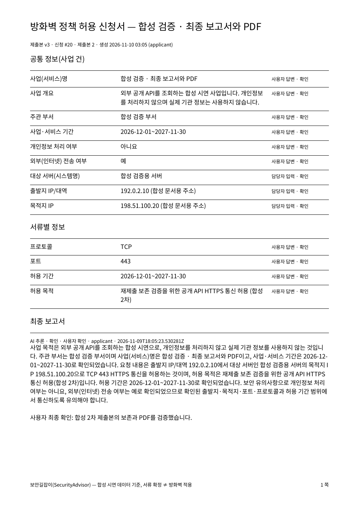

# 최종 보고서 확인·제출과 PDF 검증

검증일: 2026-11-10 (Asia/Seoul). Front #30 / Back #3. F-06·F-07의 최종 서술과 제출본 다운로드를 연결했다. 규정 기준은 PROJECT_CONTEXT v3.4, FUNCTIONAL_SPEC v1.11, AGENTS v1.16이며 디자인 기준은 prototype-soo `563dd7e76aeeb4fe63f010bec9cd1f9bac16d5dc`와 MERGE_NOTES.md다.

## 구현한 흐름

1. 3단계 신청 상세의 넓은 본문 영역에서 AI 최종 초안을 작성하거나 직접 작성한다.
2. 사용자가 본문을 수정하고 **내용 확인·저장**을 누른다. AI 출처·원문·모델은 유지하고 확인자·시각을 별도로 기록한다.
3. 미확정·수정 중·원본 변경 상태에서는 화면의 최종 제출을 막는다. 서버도 생성한 초안의 최신 원본 기준과 확인 상태를 검사한다.
4. 최종 제출 시 답변·설정 버전·확인한 최종 본문을 불변 스냅샷에 보존한다.
5. 신청 상세·문서함·과거 제출본에서 실제 PDF를 받는다. PDF 생성 요청에 제출본 ID를 명시하며 현재 답변으로 과거 제출본을 대체하지 않는다.

AI 장애 시 직접 작성 경로를 쓸 수 있다. 확인 실패 시 편집 내용은 탭 메모리에 유지된다. 새로고침 전 서버에 저장하지 않은 편집의 영속 보존을 보장하지 않는다. 모의 모드에서는 같은 최종 보고서 API 흐름을 제공하지만 PDF는 실제 서버 연결이 필요하다고 안내한다.

## 자동 검사

- Front: `npm run format && npm run check` — 26개 파일, 242개 테스트 통과. 타입·린트·규칙 문서 9종 검사 포함.
- Back: `gradlew.bat spotlessApply check -PexportOpenApi=true` — 전체 검사 통과(150건 중 149건 통과, 별도 실제 모델 테스트 1건 조건부 제외). PostgreSQL Testcontainers, 권한, 미확정 제출 차단, 원본 변경 무효화, 늦은 AI 응답 충돌, 사람 확인, 멱등 제출, PDF 본문 추출과 긴 서술의 페이지 넘김 포함.
- Docker: `node tools/runBackendTestServer.mjs --backend ..\back` — Front 프로덕션 빌드, Back·Front·DB 기동 및 상태 검사 통과.
- `npm run test:connection` — 프록시·익명 401·CSRF 없는 변경 403·로그인·사업 목록·로그아웃 통과.

## 실제 사용자 흐름과 출력

기존 6번 사업 대신 별도 합성 사업 11 / 방화벽 신청 20을 사용했다. 개인정보 없음, 공개 문서용 주소, 합성 시스템명으로 준비했으며 사업·협의 준비는 역할별 API를 이용했다. 실제 모델은 도커에 설정된 OpenRouter DeepSeek 구성을 사용했다.

데스크톱 Chrome의 `http://127.0.0.1:3001/requests/20`에서 다음을 직접 조작했다.

- AI 최종 초안 작성 → 미확정 표시와 제출 비활성화.
- 본문 수정 → 내용 확인·저장 → 제출 활성화.
- 원본 허용 목적 변경 → 원본 변경 경고와 제출 차단.
- AI 재생성 → 수정·확인 → 새로고침 후 저장 내용과 확인 상태 유지.
- 제출 확인 대화상자 → 1차 제출본 생성 → 미리보기에서 최종 서술 확인.
- PDF 다운로드 클릭 → 실제 `신청_20_제출본_1.pdf` 파일 생성(19,240바이트).

이후 브라우저 도구가 현재 URL을 신뢰할 수 있게 확인하지 못해 화면 조작을 종료했다. 브라우저 재조작을 우회하지 않고 서버 검사와 로컬 PDF 렌더링으로 후속 검증을 진행했다. 원본 변경 후 남아 있던 성공 문구, 최종 서술의 미확정 건수, PDF 표 선 겹침과 예/아니요 표시는 후속 수정했으며 이 수정은 자동 검사와 API·PDF 출력으로 확인했다.

API 추가 검증: 4→3 반환 → 허용 목적 변경 → 3→2 반환 → INFRA·SECURITY 재검토 → 실제 AI 재생성 → 사용자 확인 → 2차 제출. 협의 미완료 상태의 제출이 422로 거절되는 것도 확인했다. 1차 스냅샷은 전후 완전히 같았고, 두 제출본 각각의 최종 본문으로 PDF를 받았다.

| 항목 | 최종 확인 결과 |
|---|---|
| 신청 20 | 4단계 제출됨, 최신 제출본 2(개정 2) |
| 1차 제출본 PDF 재출력 | 문서 2, 19,308바이트, 최초 서술 보존 |
| 2차 제출본 PDF | 문서 3, 17,975바이트, 새 서술·사용자 확인 포함 |
| PDF 시각 검사 | A4 1쪽, 한글·표 간격·예/아니요·최종 본문·바닥글 확인 |

## 호환 범위와 남은 검증

- 기존 API 클라이언트의 최종 서술 없는 신청은 답변만 제출하는 호환 경로를 유지한다(Back ADR 0008). 새 화면은 AI 또는 직접 작성 후 확인을 요구한다.
- 좁은 화면·전체 키보드 이동·화면 낭독기 평가는 이번 실행에서 완료하지 않았다. 후속 UI 수정도 브라우저에서 재확인하지 않았다.
- HWP/HWPX 출력, 기관별 공식 서식과 인쇄 품질, 전자결재 전송은 이번 범위가 아니다.
- 도커는 이번 기능 브랜치 코드로 빌드했고 DB 볼륨은 보존했다. main 병합과 배포 저장소 릴리스 스냅샷 갱신은 별도다.
