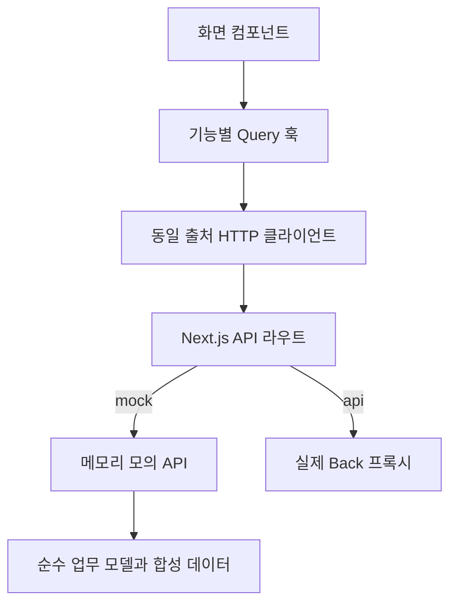

# 프론트엔드 구조와 개발 시작점

기록일: 2026-11-07. Next.js App Router 기반의 신규 Front 개발 시작점이다. 화면과 모의 API는 이 저장소가 소유하며, 실제 업무 서버·DB·OpenAPI는 Back 저장소가 소유한다. 완성본 통합 배포는 별도 Security-Advisor 저장소에서 다룬다.

업무 기준은 [FUNCTIONAL_SPEC.md](../FUNCTIONAL_SPEC.md), 개발 규칙은 [AGENTS.md](../AGENTS.md), 디자인 기준과 차이는 [DESIGN_PARITY.md](DESIGN_PARITY.md)에 있다. 실제 Back과의 계약 경계는 [contract/README.md](../contract/README.md)를 먼저 확인한다.

## 실행 모드와 데이터 경로

브라우저는 같은 출처의 `/api/...`만 호출한다. [httpClient.ts](../lib/httpClient.ts)가 요청·CSRF·ProblemDetail 처리를 모으고, [API 라우트](../app/api/[...path]/route.ts)가 서버 환경변수 `API_MODE`로 모의 API와 실제 Back 프록시를 선택한다. 실제 모드의 실패를 합성 데이터로 대체하지 않는다.

`npm run dev`는 모의 모드를, `npm run dev:api`는 실제 Back 모드를 명시적으로 선택한다. [실행 스크립트](../tools/runNext.mjs)가 개발 프로세스의 모드를 설정한다. 운영 실행에서 `API_MODE`를 지정하지 않으면 실제 API 모드가 기본이다. 명시적인 `API_MODE=mock`은 개발·합성 시연용이다.

모의 API는 Node 프로세스 메모리에 상태를 보관한다. 서버 재시작 시 계정·세션·신청·감사 이력이 초기화되며, 여러 프로세스가 공유하는 데이터베이스 역할을 하지 않는다. 모의 업무 모델은 요구사항과 화면의 경계를 검증하기 위한 것으로, 실제 Back의 구현을 복사하거나 대체하지 않는다.

## 코드 위치와 책임

| 위치                      | 책임과 시작 파일                                                                                                                                                                                                                        |
| ------------------------- | --------------------------------------------------------------------------------------------------------------------------------------------------------------------------------------------------------------------------------------- |
| `app/`                    | App Router 경로, 한국어 문서 루트, 공통 Provider, 오류·없는 경로 처리. 페이지 파일은 기능 컴포넌트를 연결                                                                                                                               |
| `components/`             | [ServiceShell](../components/ServiceShell.tsx), [공통 UI](../components/ui/Common.tsx), [인라인 SVG 아이콘](../components/ui/Icon.tsx), 구현 예정 안내                                                                                  |
| `features/auth/`          | 로그인·가입·현재 세션, 계정 조회와 역할 변경 훅. [useAuth.ts](../features/auth/useAuth.ts)에 현행 Back 인증 응답 어댑터 포함                                                                                                            |
| `features/request/`       | 신청 생성·목록·상세·사업 공통 인터뷰, 답변·보완·제출·반환 UI. [types.ts](../features/request/types.ts), [useRequests.ts](../features/request/useRequests.ts), [domain.ts](../features/request/domain.ts)가 데이터·HTTP·모의 규칙을 분리 |
| `features/assignment/`    | [계정·담당자 관리](../features/assignment/MemberManagement.tsx). 신청의 자동 배정·재배정 규칙은 모의 업무 모델에, 재배정 UI는 신청 상세에 위치                                                                                          |
| `features/document/`      | [문서함](../features/document/DocumentList.tsx): 초안·제출 스냅샷 조회, 텍스트 미리보기, JSON 다운로드                                                                                                                                  |
| `features/audit/`         | [읽기 전용 감사 이력](../features/audit/AuditList.tsx). 감사 데이터의 생성과 접근 검사는 모의 API 책임                                                                                                                                  |
| `features/configuration/` | [설정 기준 안내](../features/configuration/ConfigurationPage.tsx). 현재 편집·게시 저장 기능은 없음                                                                                                                                      |
| `lib/`                    | HTTP 전송, ProblemDetail, API 프록시, 공통 DTO, 설치 정보·감사 Query, 계정·자원별 작성 중 입력과 선택 파일의 일시적인 메모리 참조                                                                                                       |
| `mocks/`                  | [서버 API](../mocks/server.ts)와 [합성 seed](../mocks/seed.ts). 쿠키 인증·CSRF·권한·입력 검사를 거쳐 업무 모델 실행                                                                                                                     |
| `styles/`, `public/`      | 시안에서 가져온 토큰·레이아웃, 신규 UI 보정, 로컬 로고·KRDS 토큰·Pretendard GOV 글꼴과 라이선스                                                                                                                                         |
| `tests/`                  | [업무 모델 시나리오](../tests/domain.test.ts), [HTTP·인증 경계](../tests/http.test.ts). 실행 결과는 PR에서 보고                                                                                                                         |

기능 폴더는 화면이 다루는 컨텍스트의 경계다. `review`, `document`, `assignment`, `audit` 등 실제 서버 바운디드 컨텍스트 전체가 이 저장소에 구현되었다는 뜻은 아니다. `policy`, `insight`, `notification`, `knowledge`, `llm`의 운영 기능은 이후 Back 계약과 범위 결정에 따라 연결한다.

## 화면과 역할

| 경로                | 이용 범위와 동작                                                                                                |
| ------------------- | --------------------------------------------------------------------------------------------------------------- |
| `/login`, `/signup` | 인증·가입. 모의 계정 카드는 모의 모드에서만 제공하고 회원가입 입력에 역할·기관 선택을 받지 않음                 |
| `/requests`         | 신청자는 본인 신청, 담당자는 담당 분야 조회 범위, 관리자는 관리 범위의 현황. 필터·기간·검색·페이지를 URL로 표현 |
| `/requests/new`     | 신청자가 사업 정보와 한 개 이상 서류 종류를 선택하여 사업 건·신청 생성                                          |
| `/cases/[id]`       | 접근 가능한 사업 건의 공통 답변·분석 제안·연결된 신청. 편집 가능 여부는 서버가 판단                             |
| `/requests/[id]`    | 신청 단위 상세. 서버가 반환한 `allowedActions`와 차단 사유로 업무 버튼 표시                                     |
| `/supplements`      | 보완 요청 목록에서 각 신청의 답변 영역으로 이동                                                                 |
| `/documents`        | 접근 가능한 신청의 문서 데이터와 제출 스냅샷                                                                    |
| `/history`          | 담당자·관리자 메뉴에서 처리·검토·감사 이력 조회. 데이터 범위는 API가 검사                                       |
| `/network`          | ICT인프라 담당자용 통신 정보 조회. 변경은 신청 상세에서 처리                                                    |
| `/members`          | 기관 관리자용 계정 역할·활성 상태 관리와 사유 기록                                                              |
| `/settings`         | 기관 관리자용 질문·절차·양식·기한·게시본 기준 안내                                                              |
| `/policies`         | 정책 수명주기 P2 구현 예정 안내                                                                                 |

일반 사용자·ICT인프라·정보보안·기관 관리자 네 역할만 사용한다. 역할별 메뉴는 사용성을 위한 표시이며 접근 제어의 최종 근거가 아니다. 서버는 세션에서 사용자를 읽고, 본인 신청 여부·배정·현재 단계·revision을 다시 검사한다. 담당자는 같은 분야의 신청을 조회할 수 있어도 자신에게 배정되지 않으면 검토 행위를 수행할 수 없다.

운영 기관은 설치당 하나다. [환경변수 예제](../.env.example)의 `INSTITUTION_NAME`·`INSTITUTION_CODE`를 사용하며 기관 테이블, 기관 선택 화면, `institutionId` 기반 멀티테넌트 모델을 두지 않는다. 현재 설치 정보 조회의 실제 Back 계약은 미확정이다.

## 업무 데이터와 흐름

BusinessCase는 사업 공통 답변(`scope=CASE`)을 보유한다. SecurityRequest는 서류 종류·개별 답변(`scope=REQUEST`)·상태·배정·협의·보완·반환·제출본을 보유한다. 사업 한 건에서 방화벽신청서와 보안성검토 신청서를 함께 만들 수 있으며, 한 신청의 전이가 형제 신청의 상태를 변경하지 않는다.

흐름은 작성 → 담당자 협의 → 사용자 최종 검토 → 확정·관리다. 협의 진입 시 분야별 자동 배정, INFRA 자원 할당, 각 분야 협의 완료를 분리한다. 최종 제출은 현재 답변과 설정 게시본 버전의 스냅샷을 만들고, 제출본에 대한 INFRA·SECURITY 최종 확인 뒤 SECURITY가 서류를 확정한다. 실제 방화벽 적용 기능은 이 흐름에 포함되어 있지 않다.

[모의 업무 모델](../features/request/domain.ts)은 UI와 독립된 함수로 다음 불변식을 검사한다.

- 출처는 사용자 답변·AI 추론과 근거·담당자 입력·담당자 확인을 구분한다. 확인 기록 없는 AI 제안은 미확정이다.
- 단계 반환은 2→1, 3→2, 3→1, 4→3 경로만 허용하고 사유·보완 항목을 받는다. 종결·철회 역시 사유와 기존 기록을 보존한다.
- `expectedRevision`으로 오래된 수정 요청을 거부한다. 제출은 멱등 키를 사용한다.
- 공통 답변 변경은 수정 가능한 미제출 신청에 반영하고 재검토 필요 상태를 표시한다. 제출 스냅샷은 바꾸지 않는다.
- 처리 기한은 서버 측 모의 모델에서 영업일 기준으로 계산한다. 기한이 지나도 신청 상태는 자동 변경하지 않는다.
- 성공한 업무 변경과 감사 추가를 같은 모의 상태 갱신으로 묶는다. 이는 실제 DB 트랜잭션의 구현·검증을 의미하지 않는다.

선택 파일은 [uploadDraft.ts](../lib/uploadDraft.ts)의 계정·사업별 탭 메모리에만 보관하며, 사용자가 분석 요청을 실행할 때 전송한다. 현재 모의 분석은 파일 내용을 해석하지 않고 합성 제안을 반환한다. 제안 적용은 서버에 저장된 분석 작업 식별자와 revision으로 요청하고, 적용 후에도 사람의 확인이 필요하다.

## 상태·오류·세션

[Providers](../app/Providers.tsx)가 클라이언트 트리마다 TanStack Query Client를 만든다. 업무 데이터는 Query 캐시, 작성 중 입력은 컴포넌트 상태와 계정·자원별 탭 메모리, 공유할 목록 조건은 URL에 둔다. 업무 데이터·세션 토큰을 `localStorage`에 저장하지 않는다. 계정 변경·로그아웃 성공 시 이전 사용자의 Query 캐시를 제거한다.

[inputDrafts.ts](../lib/inputDrafts.ts)는 새 신청, 사업 공통 인터뷰·분석 입력, 공통·서류별 답변의 미저장 초안을 `actor.id`와 자원 키로 나눈다. 같은 탭에서 화면을 이동하거나 세션 만료 후 같은 계정으로 돌아오면 해당 계정의 입력을 복원하고, 다른 계정에는 그 초안을 표시하지 않는다. 저장·생성·제안 적용 성공 후 해당 초안을 해제한다. 비밀번호·세션·권한은 보관하지 않으며 새로고침·탭 종료 후 복원을 보장하지 않는다. 이 메모리는 서버 저장이나 브라우저 영속 저장을 대신하지 않는다.

Query와 mutation은 자동 재시도를 기본으로 끄고, 로딩·빈 상태·실패 상태를 분리한다. 401은 로그인 필요, 403은 허용되지 않은 행위, 404는 없음 또는 비공개 타인 자원, 409는 revision·중복 충돌, 422는 업무 조건 위반으로 다룬다. 실패를 성공 토스트로 바꾸거나 입력 내용을 임의로 지우지 않는다.

현재 Back 인증은 `/api/auth/login`, `/api/auth/logout`, `/api/auth/me`를 사용한다. 새 REST 자원 명명 규칙과 다른 현행 경로를 인증 어댑터에 한정해 연결하며, Back 소유 계약을 Front에서 독자적으로 바꾸지 않는다. Back 응답에 없는 회원 `id`는 화면 내부에서 `username`으로 대응하고, 부서는 빈 값·세션 만료시각은 `null`로 둔다. 이 변환을 실제 서버의 회원 ID·활성 상태·만료 계약으로 간주해서는 안 된다.

모의 세션은 HttpOnly 쿠키와 CSRF 쿠키·헤더를 사용한다. 실제 Back 프록시는 쿠키와 허용된 헤더만 전달한다. 세션 만료 경고와 연장은 만료시각이 제공되는 모의 세션에서 지원하며, 실제 Back의 만료·연장 계약은 추가 연결이 필요하다.

## 변경할 때의 시작점

| 작업                     | 먼저 확인할 코드·문서                                                                 |
| ------------------------ | ------------------------------------------------------------------------------------- |
| 목록·상세의 모양 변경    | 최신 시안과 MERGE_NOTES → [DESIGN_PARITY](DESIGN_PARITY.md) → 해당 기능 TSX·화면 CSS  |
| 상태·권한·반환 규칙 변경 | FUNCTIONAL_SPEC → Back 계약 협의 → `types.ts`·`domain.ts`·도메인 시나리오·업무 훅     |
| 실제 API 연결            | [계약 기록](../contract/README.md) → Back OpenAPI 확정 → DTO·응답 스키마·훅·오류 처리 |
| 설치·전송 설정           | `.env.example` → `lib/serverProxy.ts` → `app/api/[...path]/route.ts`                  |
| 데이터 출처·문서 출력    | `AnswerEditor.tsx`·`DocumentList.tsx` → 제출 스냅샷·문서 API 계약                     |

실행·검사 명령의 기준은 [package.json](../package.json)이다. `npm run format:check`, `npm run typecheck`, `npm run lint`, `npm test`, `npm run check:docs`, `npm run build`를 변경 목적에 맞게 수행하고 실제 결과를 기록한다. 자세한 의존성·프록시·모의 API 선택 이유는 [ADR 0001](adr/0001-frontend-foundation.md), 미구현·미검증 범위는 [KNOWN_LIMITATIONS](KNOWN_LIMITATIONS.md)에 정리한다.
