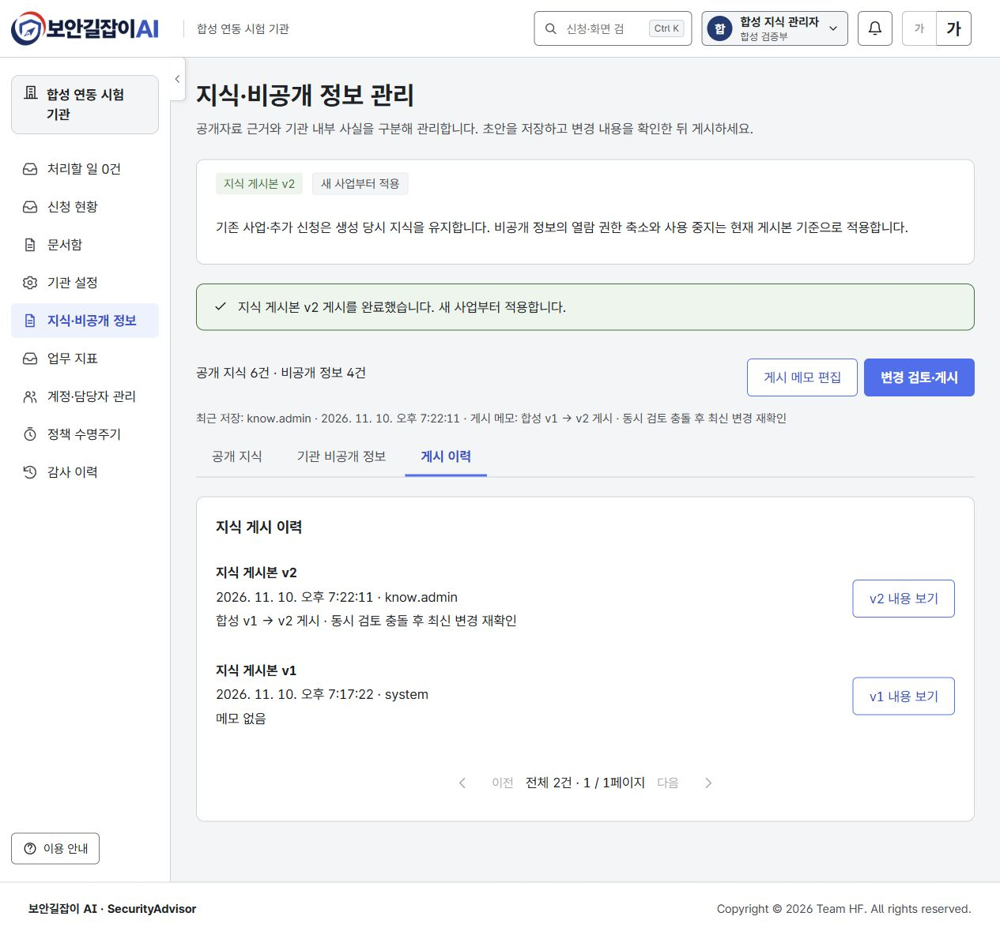
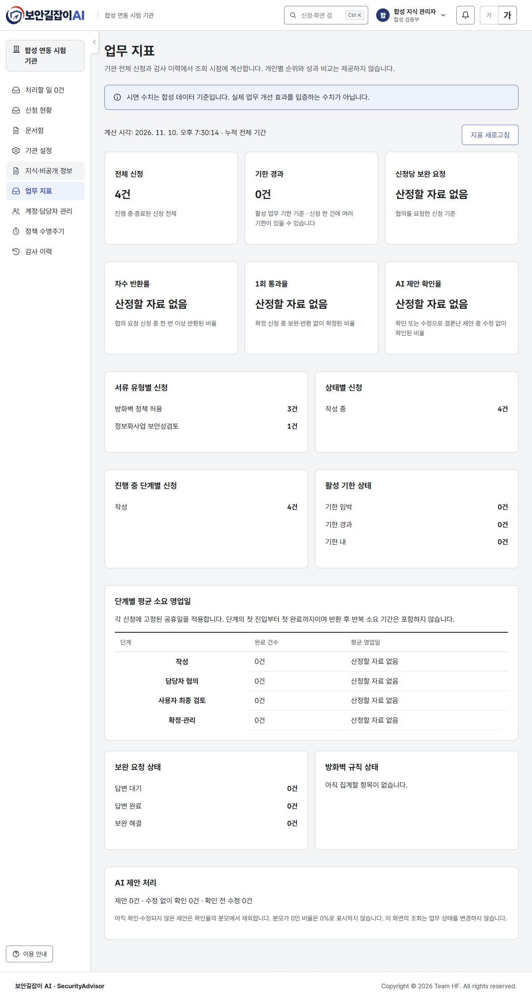
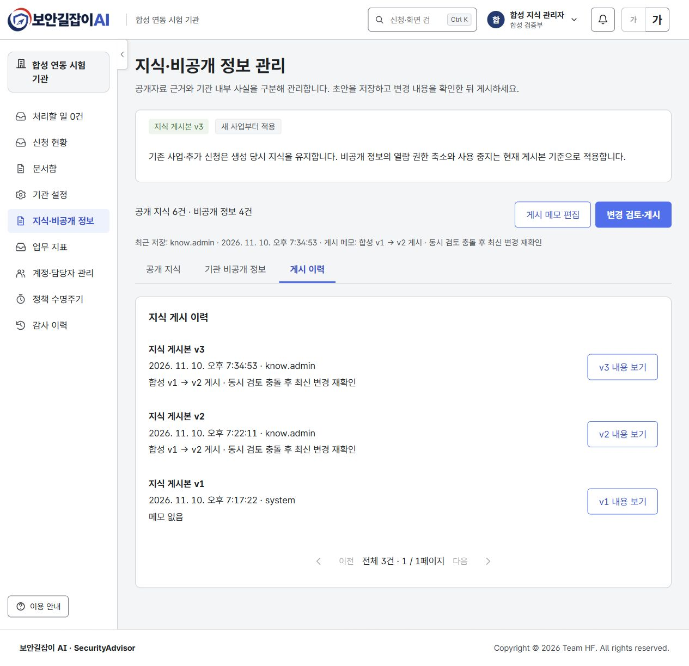
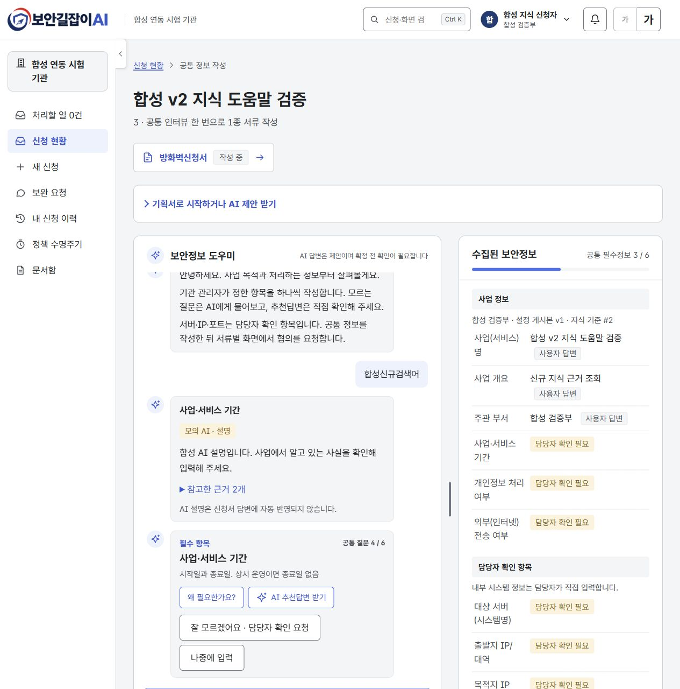

# 지식·비공개 정보 관리와 관리자 업무 지표

기준: Back PR [#20](https://github.com/team-khfc/Security-Advisor-Back/pull/20), Front #52, 2026-11-10.

## 화면과 업무 경계

관리자 메뉴에 `/knowledge`와 `/insights`를 추가했다. 공개 지식은 자료명·판본·출처 위치·발췌 본문·적용 질문/서류를, 비공개 정보는 종류·이름·별칭·속성·열람 역할·관리 메모를 관리한다. 초안은 저장만으로 조회와 AI에 적용되지 않는다. 변경 전후와 게시 메모를 확인하고 게시해야 신규 사업에 적용된다. 질문·기한 설정 게시본과 지식 게시본은 별도이며 사업 화면에 두 기준을 구별해 표시한다.

항목과 게시 메모의 충돌에서는 내 입력을 보존하고 최신 서버 내용을 조회한 뒤 명시적으로 대체한다. 게시 검토 후 다른 저장이 있으면 409로 게시를 막고 변경 비교를 다시 한다. 편집 내용은 화면 메모리에만 있으며 영구 자동 저장하지 않는다. 저장하지 않은 입력의 닫기·새로고침을 안내한다. 전체 초안/게시 사본과 비교 원문은 관리자만 요청한다.

기존 사업과 추가 서류는 생성 당시 지식 기준을 유지한다. 비공개 값은 해당 사본에서 읽지만 현재 게시본이 열람 권한을 줄이거나 사용을 중지한 항목은 과거 사본에서도 담당자 조회에서 제외한다. 이미 사람이 작성·확인한 신청 값·문서·질의 기록을 소급 삭제하지 않는다. 신청자에게 비공개 자료 관리 메뉴와 원문을 제공하지 않는다.

업무 지표는 기관 전체의 서류·상태·단계·기한·보완·반환·AI 제안·방화벽 규칙을 조회 시 계산한다. 계산 시각과 분모, 미산정 상태를 표시하며 개인별 순위를 만들지 않는다. 지표는 편집·게시 대상이 아니다. 각 사업의 고정 기한 정책으로 영업일을 계산한다. 모의 모드는 현재 상태 집계 위주이며 정확한 단계 소요 시간/AI 확인율은 백엔드 연동 환경에서 검증한다.

## 실제 도커 검증

별도 `securityadvisor-knowledge-qa` 환경(Front 3012, Back 8092, 독립 DB)에서 합성 계정 4개, 사업 3건, 신청 4건과 지식 v1·v2를 사용했다. 외부 AI는 호출하지 않았고 실제 장비를 변경하지 않았다.

| 검증 | 결과 |
|---|---|
| 관리자 공개 지식 필수 자료명 누락 | 저장 차단, 입력 수정 후 초안 저장 |
| 공개 지식 본문·판본·적용 질문 및 비공개 서버 속성 수정 | 초안 저장 성공, 게시 전 공개 검색과 기관 사실은 v1 유지 |
| 두 창의 같은 항목 수정 | 뒤늦은 저장 409, 입력 보존·최신 내용 비교·명시적 대체 |
| 변경 비교 후 다른 창에서 게시 메모 저장 | 오래된 비교본 게시 409, 다시 비교 후 v2 게시 성공 |
| v1·v2 게시 이력, 전체 사본·당시 전후 비교 | 불변 사본과 메모 확인, 페이지 크기 1의 다음 페이지 API 확인 |
| v1 기존 사업과 v2 신규 사업 | 사업 1은 #1, 화면에서 만든 사업 2와 도움말 검증 사업 3은 #2 유지 |
| 기존 사업에 보안성검토 추가 | 신청 4도 기존 사업의 지식 기준 #1 사용 |
| 공개 검색·질문 도움말·기관 사실 API | v1·v2 기준별 결과 유지, 신규 지식과 합성 IP 변화 구분 |
| 신청자/인프라/보안 역할 | 관리자 초안·게시 이력·원문·비교·업무 지표 API 403. 신청자 화면도 관리 정보 조회 차단 |
| 업무 지표 | 실제 신청 합계 4건(방화벽 3·보안성검토 1), 분모 없는 비율은 미산정, 조회 전후 사업 내용 불변 |
| v3에서 합성 인프라 역할의 열람 권한 회수 | 게시 전 권한 유지, 게시 후 v1/v2/v3 조회 차단, 보안 역할은 v1/v2 각각의 값 유지 |
| 키보드 | 좌우 방향키로 지식 탭 선택·초점 이동, Escape로 미변경 편집 창 닫기 |
| 좁은 화면 | 실제 측정한 520px 창에서 문서 너비 500px, 편집 창 460px, 지표 단일 열 468px로 가로 넘침 없음 |

API 검증 31개와 권한 회수 검증 7개를 통과했다. 화면 검증 중 최신 초안으로 교체한 뒤 불필요한 미저장 경고가 나오는 문제를 수정했고, 도커 재빌드 후 동일 충돌을 재현해 정상 닫기를 확인했다. 최종 게시 검토에는 최신 메모도 표시한다. 검증용 임시 편집은 게시 내용과 동일하게 복원했다.

내장 브라우저의 크기 조정이 적용되지 않아 좁은 화면은 Chrome에서 확인했다. Chrome의 화면 캡처는 시간 초과가 발생해 좁은 화면은 실제 DOM 너비·열 배치·키보드 조작으로 확인했고, 증거 이미지는 내장 브라우저의 실제 도커 화면이다.

기존 3001/8081 연동 환경은 남아 있던 데이터 볼륨으로 다시 구동했다. 마이그레이션 전후 **268개 신청·71개 계정**과 사업·신청·질문 설정 사본의 전체 해시를 비교해 보존을 확인했다. 지식 초기 게시본 v1과 전체 신청 지표 268건 조회도 통과했다. 합성 QA 게시본은 기존 환경의 게시본을 바꾸지 않는다.

## 자동 검사와 참조

- Front: `npm run format && npm run check` — 37개 파일, 314개 테스트 통과. 타입·린트·문서 9종 검사 포함.
- Back: `spotlessApply check` — 183개 중 181개 통과, 선택 검사 2개 생략. OpenAPI 별도 export 검사 통과.
- 양쪽 Docker 운영 빌드·구동 성공. 백엔드 없이 모의 API에서도 초안 미노출·게시·버전 고정·권한 및 충돌을 검사한다.
- 디자인: `team-khfc/prototype-soo` 기본 브랜치 `563dd7e76aeeb4fe63f010bec9cd1f9bac16d5dc`, README·MERGE_NOTES·기존 settings 구성/토큰을 기준으로 확장했다. 전용 지식·지표 시안은 없다.
- 후속 범위: 공개 원문 수집·벡터 색인·LLM 구성 관리, 대량 자료의 검색 인덱스, 지표 DB 집계·기간 필터. 이번 지표는 전체 누적 기준이다.

## 실제 화면

