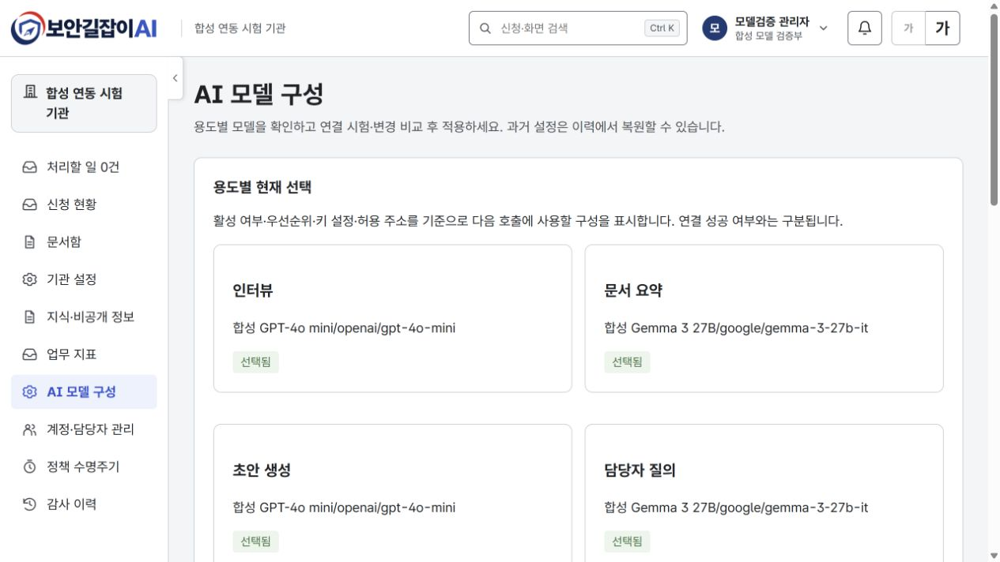
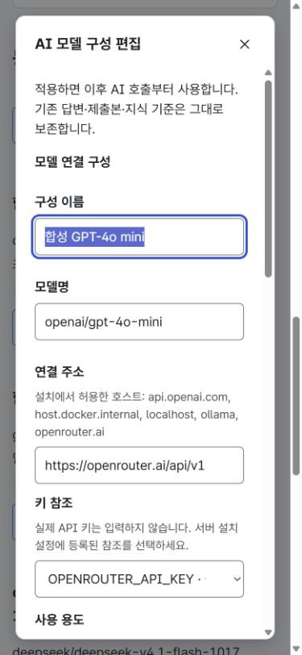
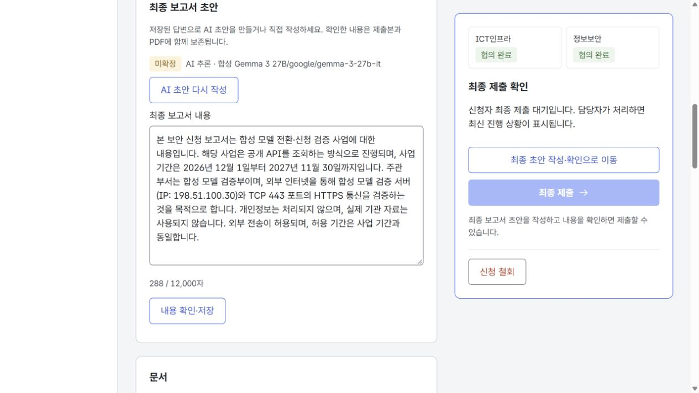

# 관리자 AI 모델 구성·연결 점검 검증

2026-11-10 · Back 이슈 #21 · Front 이슈 #54

## 구현 범위

관리자 메뉴의 /models에서 인터뷰·문서 요약·초안 생성·담당자 질의용 구성의 이름, 모델, 연결 주소, 키 참조, 용도, 응답 다양성, 응답 한도, 시간 제한, 우선순위와 활성 상태를 편집한다. 실제 키 값은 화면에서 받지 않는다. 설치의 LLM_ALLOWED_KEY_ENVS 허용 목록과 키 설정 여부만 보여 준다. 낮은 우선순위 숫자가 먼저이며 같은 숫자는 구성 ID 순이다.

입력은 변경 비교 후 적용한다. 적용 전 연결 시험은 별도 동작이며 저장하지 않는다. 적용은 이후 AI 호출부터 사용하고 기존 신청·답변·출처·제출본을 다시 쓰지 않는다. 새 기관 질문·지식 게시본과 달리 신청마다 모델을 고정하지 않는다. 편집 중 입력은 화면 메모리에만 있으며 닫기 전에 미저장 확인을 제공한다.

생성·변경·복원은 작성자·시각·사유·버전과 전체 설정 사본을 남긴다. 과거 이력은 수정·삭제할 수 없고 복원은 사유를 가진 새 변경이다. 비교 후 다른 수정이 있으면 409로 적용을 막는다. 화면은 내 입력을 보존하고 최신 구성 확인·명시적 교체를 제공한다.

## 도커와 실제 모델

별도 securityadvisor-llm-qa 환경(Front 3013 / Back 8093 / 독립 DB)에서 합성 계정과 사업·신청을 준비했다. 실제 기관 자료와 장비는 사용하지 않았다. 설치된 OpenRouter 키를 환경변수로만 읽었다.

| 검증 용도 | GPT-4o mini | Gemma 3 27B |
|---|---|---|
| 모델 식별자 | openai/gpt-4o-mini | google/gemma-3-27b-it |
| 실제 연결 시험 | 성공 | 성공 |
| 인터뷰 | 실제 답변·모델 출처 확인 | 실제 답변·모델 출처 확인 |
| 문서 요약 | 합성 TXT 분석 완료·확인 필요 | 합성 TXT 분석 완료·확인 필요 |
| 담당자 질의 | 배정된 인프라의 실제 응답·근거 | 배정된 인프라의 실제 응답·근거 |
| 최종 보고서 | 실제 생성·미확정 | 실제 생성·미확정 |

실제 업무 검증 사업·신청은 #2, 각 모델 구성은 #4·#5다. 인터뷰 #1·#2, 분석 #1·#2, 담당자 대화 #1, 최종 초안 #1·#2에서 해당 모델 출처를 확인했다. 모델 전환만으로 신청 내용이 달라지지 않았고, 이후 복원·전환 후에도 기존 인터뷰 이력을 보존했다. 응답 생성 직후와 DB 재조회 사이 시각의 나노초/마이크로초 정밀도 차이는 콘텐츠 변경으로 취급하지 않았다.

인터뷰·초안은 GPT, 요약·담당자 질의는 Gemma로 나누어 선택되는 것도 확인했다. API 통합 검사 22개와 기존 인터뷰 이력 보존 검사, 최종 이미지 추가 검증을 통과했다.

| 경계와 실제 화면 | 결과 |
|---|---|
| 관리자 화면에서 두 모델 연결 시험 | 각각 연결 성공·소요 시간 표시 |
| GPT 응답 다양성 0.2 → 0.25 | 변경 전후 비교 후 적용 |
| 과거 0.2 값 복원 | 사유 입력·비교·새 이력 추가 |
| 두 관리자 세션의 같은 구성 수정 | 한 건 성공·다른 건 409, 미저장 입력 보존·최신 값 확인 |
| 비교 후 다른 관리자 수정 | 오래된 비교본 적용 차단 |
| 이력 페이지 조회 | 페이지 크기 1로 과거 사본 조회·불변 확인 |
| 키 미설정·잘못된 모델 | 명시적 FAILED 결과, 저장된 설정 유지 |
| 허용되지 않은 환경변수 참조 | POSTGRES_PASSWORD 참조 422, 외부 호출 차단 |
| 신청자·인프라·정보보안 역할 | 관리자 목록·선택 상태·이력·시험 결과 API 403 |
| 신청자 /models 직접 방문 | 관리자 전용 안내, 관리자 데이터 조회하지 않음 |
| 합성 신청 상세 | Gemma 생성 본문과 미확정 출처 표시, 사람 확인 전 제출 차단 |
| 390×844 화면 | 문서 폭 375px, 편집 창 약 335px, 가로 넘침 없음 |
| 키보드 | Enter로 열기, Tab·Shift+Tab 순환, Escape 후 열기 버튼으로 초점 복귀 |

## 검증 중 수정한 문제

1. Spring AI 2.0.1은 /v1을 자동 추가하지 않아 기존 OpenRouter /api 주소가 실패했다. 업무 호출과 시험에 공통 주소 호환 처리를 추가했다. 루트 주소·OpenRouter /api만 호환하고 명시한 경로는 유지한다. 최종 도커에서 두 모델 모두 기존 /api 주소로 연결 성공했다.
2. SDK 인증 실패의 실제 예외 타입을 분류하고 시험 자동 재시도를 껐다. 로컬 합성 HTTP 서버로 요청 경로·토큰 한도·인증 실패·빈 응답·재시도 없음도 검사했다.
3. 새 도커 볼륨의 업로드 폴더가 root 소유여서 파일 업로드가 실패했다. 이미지가 폴더를 app 소유로 준비하도록 수정했다. 최종 이미지의 app:app 권한과 재시작 후 합성 TXT 업로드를 확인했다.
4. 충돌 복구 후 목록이 이전 값을 표시하는 문제를 갱신 처리로 수정했다. 대화상자를 닫을 때 초점이 사라지는 문제와 모바일 이중 스크롤도 수정하고 실제 화면에서 재검증했다.

## 자동 검사와 기존 데이터

- Back: spotlessApply check, PostgreSQL Testcontainers·동시성·SDK 시험 포함 190개 통과. OpenAPI 내보내기·계약 일치와 규칙 문서 9종 검사 통과.
- Front: format, check(타입·린트·38개 파일 321개 테스트·규칙 문서 9종) 통과. 모의 API는 실제 연결 성공을 가장하지 않고 SIMULATED로 구분한다.
- 3001 도커에도 기능을 반영했다. 기존 신청 268건·계정 71개·지식 게시본 1개, 별도 지식 검증 환경의 신청 4건·계정 9개·게시본 3개를 보존했다. 8개 업무 테이블의 건수·해시가 전후 동일하다. 기존 기능 조회·권한 점검 34개도 통과했다.
- 3001은 기존 업무 시연 모드를 유지하고 기존 모델 3개의 BASELINE 이력을 생성했다. 실제 모델 검증은 3013에서 수행했다. 병합 전 기능 브랜치 이미지이며 main 병합을 의미하지 않는다.

디자인 기준: prototype-soo 563dd7e76aeeb4fe63f010bec9cd1f9bac16d5dc의 MERGE_NOTES, 기관 설정 화면과 공통 토큰. 모델 관리 전용 시안은 없어 현재 관리자 화면의 카드·입력·대화상자·글자 크기를 재사용했다.

연결 성공은 답변 품질 평가나 모든 모델 옵션의 호환 보장이 아니다. 시험은 고정 합성 문장, 최대 30초·512토큰, 프로세스당 동시 2건으로 제한한다. 키 회전·허용 호스트 편집은 서버 설치 설정의 책임이며 실제 키 값이나 원격 시험 응답 원문은 저장하지 않는다.

## 실제 화면

