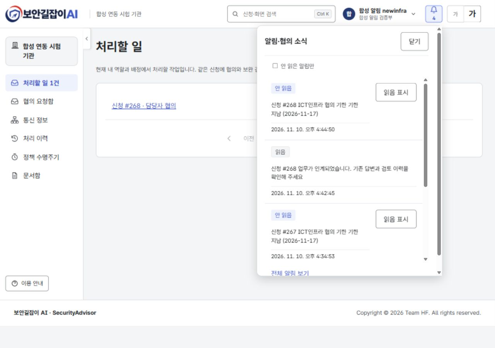
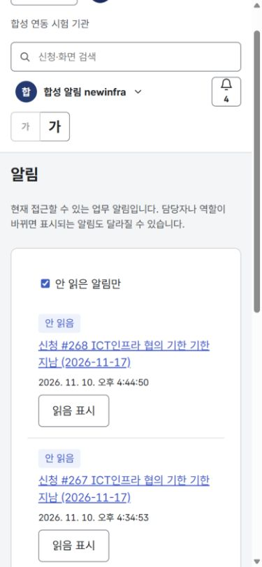

# 업무 인계 알림함·처리할 일

2026-11-10. Front main `d077e7d`, Back main `aedb5ab` 이후 구현. 디자인 참조: `prototype-soo` 기본 브랜치 `563dd7e76aeeb4fe63f010bec9cd1f9bac16d5dc`의 MERGE_NOTES와 공통 알림 패널.

## 변경

- 머리글 알림 버튼에 실제 안 읽음 건수를 표시한다. 최근 5개 패널에서 읽음 표시·신청 이동·전체 목록으로 연결한다.
- `/notifications`는 서버 페이지(20개)와 안 읽음 필터를, `/todos`는 역할별 현재 작업과 페이지를 제공한다. 알림 읽음과 업무 완료는 별개다.
- 계정·역할별 조회 캐시를 분리하고 업무 저장·읽음 처리 뒤 다시 조회한다. 창 복귀와 30초 주기에도 현재 권한을 확인한다. 서버 거절 시 오류를 표시하고 읽음/이동 성공을 가장하지 않는다.
- 알림 패널 제목 초점, Tab 이동, Escape/닫기 후 버튼 초점 복원, 좁은 화면을 지원한다.
- 독립 개발용 모의 API도 같은 페이지/읽음 계약을 사용한다. 모의 알림은 합성 이력에서 생성하며 실제 예약 발송·외부 채널 검증을 대신하지 않는다.

## 검증

- `npm run check`: 포맷·타입·린트·문서 검사, 34개 파일 300개 검사 통과. Docker 빌드의 `npm run build` 성공.
- 추가 검사: 페이지·안 읽음·읽음 이동, 권한 오류, 패널 키보드 초점, 계정 캐시 분리, 처리할 일과 읽음 분리.
- 실제 Docker/PostgreSQL: 합성 `notice-fafe9688-*` 7개 계정, 사업 139/140·신청 267/268. Back 검증 도구의 권한·인계·기한·목록·읽음·업무 종료 22개 확인 통과.
- 관리자 화면에서 전임 ICT인프라 계정 비활성 → 관리자 알림/할 일 증가 → 알림으로 신청 268 이동 → 새 담당자에게 재배정 → 관리자 할 일 감소를 확인했다.
- 새 담당자로 로그인해 인계 알림 → 신청 이동 → 읽음 건수 감소(4→3), 담당자 협의 처리할 일은 1건 유지. 신청 268만 지정한 기한 재실행 뒤 새 담당자에게 기한 경과 알림이 보였다.
- 준비 실행 계정의 106개 알림을 6/6페이지까지 조회했다. 1280×900과 390×844에서 가로 넘침이 없고, Enter/Tab/Escape 초점 복원과 안 읽음 필터가 정상 동작했다.
- 실제 장비·외부 AI·메일·메신저 호출 없이 합성 계정·신청만 사용했다. 브라우저의 임시 화면 크기는 검증 후 복원했다.

## 배포와 남은 범위

Back의 배열→페이지 응답 변경을 포함하므로 연결된 Back PR을 먼저 병합하고 양쪽을 함께 배포한다. 계약 출처는 [contract/README.md](../contract/README.md)에 기록한다. 서버는 커밋 이후 최선 노력 방식으로 알림을 저장하며 프로세스 중단 시 자동 재전송 대기열은 제공하지 않는다. 정책 만료/연장 알림·외부 채널 실발송은 이번 범위에 포함하지 않는다.

관련 이슈: [Back #15](https://github.com/team-khfc/Security-Advisor-Back/issues/15), [Front #48](https://github.com/team-khfc/Security-Advisor-Front/issues/48).
