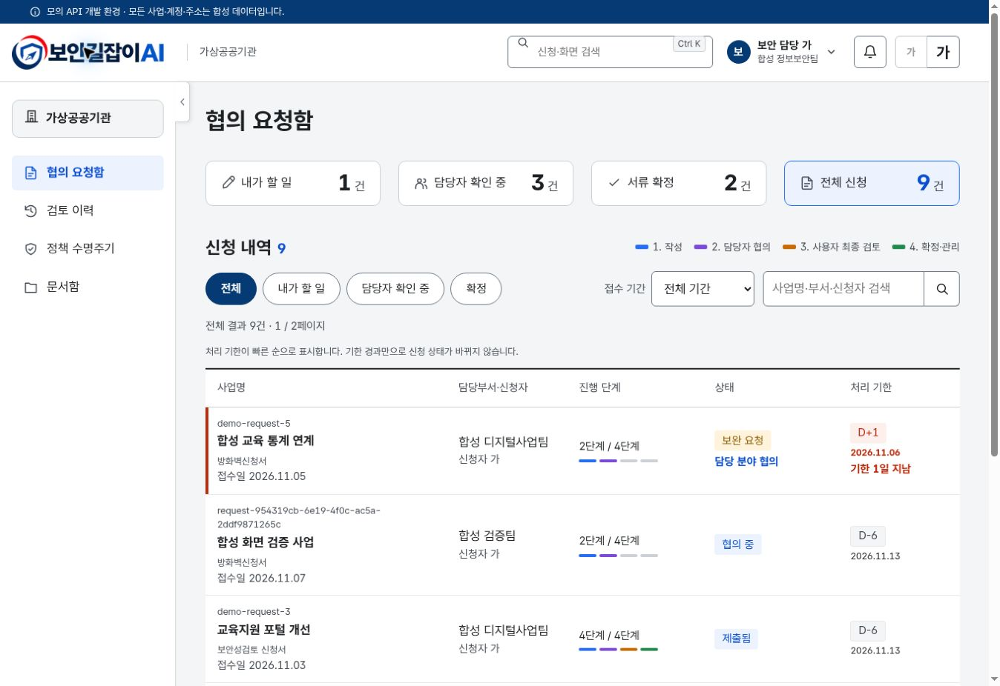
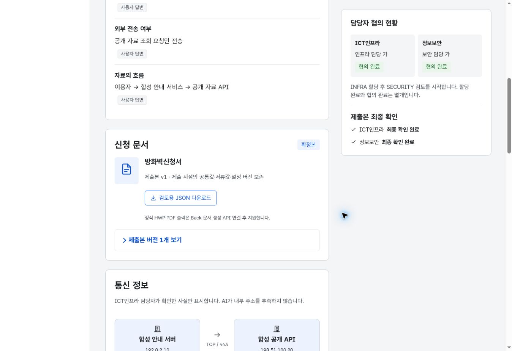

# 신규 Front 검증 기록

검증일: 2026-11-07. 합성 데이터와 서버 메모리 모의 API를 대상으로 실제 실행한 결과다. 실제 Back·LLM·운영 배포의 검증 결과가 아니다.

## 기준과 환경

- 사용자 지침 v1.13, PROJECT_CONTEXT v3.4, FUNCTIONAL_SPEC v1.11, AGENTS v1.16, PROJECT_RULES v1.14, CONTRIBUTING v0.16, CODING_STYLE v0.5, SECURE_CODING v1.4, design v3.1.
- 최신 디자인 기준: `prototype-soo` main `1af32fb424ea79a1a4ce60484a83f9d1935fef25`. 화면 작업 전 `MERGE_NOTES.md`를 읽었고 최종 검증 때 기본 브랜치 HEAD가 같은 커밋임을 다시 확인했다.
- 실제 Back 경로 확인 기준: `6253f9c7bf0d8862be1d93a32062de6bd887f68d`. 업무 OpenAPI 미확정. 자세한 경계는 [계약 기록](../contract/README.md).
- Node.js 24.22.1, npm 11.9.0, Next.js 16.4.5, React 19.3.1, TypeScript 5.9.3.
- 브라우저: Linux Chromium 기반 개발 미리보기. 기본 뷰포트 1348×936 CSS px. 400% 브라우저 확대 시 약 337~340px CSS 폭에서 반응형 메뉴·표 영역·전체 가로 넘침을 확인했다. 실제 휴대폰 및 기기 에뮬레이터 검증과는 구분한다.

## 자동 검사

| 실제 실행 명령 | 결과 |
| --- | --- |
| `npm ci` | 잠금 파일을 사용하는 설치 명령 제공. 이 작업 환경의 최초 설치는 `npm install`로 수행하여 잠금 파일을 생성했으며, CI는 `npm ci`를 실행하도록 구성 |
| `npm run format && npm run check` | 통과. Prettier, Next 경로 타입 생성·TypeScript, ESLint 경고 0, Vitest, 규정 문서 검사 |
| `npm test` (`check` 안에서 실행) | 테스트 파일 6개, 테스트 **66개 통과** |
| `npm run build` | 통과. 정적 페이지 14개 생성과 동적 사업·신청·API 경로 빌드 완료 |
| `npm audit --omit=dev --json` | 런타임 의존성 알려진 취약점 **0개**. 검사 시점의 npm advisory 결과이며 전체 보안성 보증이 아님 |
| `python3 tools/check_doc_versions.py` | 규정 9종 버전·날짜·단일 경로 및 공개본 8종 해시·연락처 형식 점검 통과 |

테스트 구성:

| 파일 | 수 | 확인한 위험 |
| --- | ---: | --- |
| `domain.test.ts` | 26 | 1:N 독립 전이, 자동 배정·자기 신청 배정 금지, INFRA 선행, 할당과 협의 분리, 보완·반환 경로·사유, 기존 값 보존, AI 출처·확인, revision, 제출본 불변·멱등성, 두 분야 최종 확인, 종결·철회, 영업일 기한, 감사의 원자적 상태 갱신 |
| `http.test.ts` | 14 | 미인증·CSRF·Next Host 비교, 역할 헤더 위조, 타인 자원 404, 회원가입 권한 상승 차단, 실패 잠금·세션 만료·로그아웃, 파일 검사·합성 분석, 실제 JSON, 프록시 제한·쿠키·Location·실패 처리 |
| `login.test.tsx` | 11 | 원래 업무 복귀, 외부 URL·역슬래시·제어 문자·인코딩 우회 차단 |
| `answers.test.tsx` | 9 | AI 미확정·근거·HTML 텍스트 처리, 출처 없음, 동시 변경 비교·입력 보존, 저장 실패 복구, 새 AI 필드 저장, 역할별 편집·확인, 계정별 복원, 타 역할 AI의 의도하지 않은 전송 방지 |
| `input-drafts.test.tsx` | 4 | 담당 부서 필수, 새 신청 계정 격리, 인터뷰 입력·기준 revision 복원, 명시적 분석 요청 |
| `session-drafts.test.tsx` | 2 | 실제 Shell의 세션 만료 분기에서 입력 숨김·동일 계정 복원, 미저장 로그아웃 취소와 승인 후 보존 |

도메인 통합 시나리오는 신규 사업·서류 2종 → AI 후보·사람 확인 → 자동 배정·INFRA 할당 → SECURITY 보완·2→1 반환 → 재확인·보완 해결 → 양 분야 협의 → AI 최종 초안·사람 확인 → 제출 → INFRA·SECURITY 최종 확인 → 확정을 실행한다. 형제 신청이 별도의 작성 상태를 유지하는 것도 검증한다.

## 브라우저에서 실제 확인한 흐름

1. 모의 일반 사용자 로그인, 신청 현황의 카드·검색·표·페이지, 로그인 후 원래 업무 경로 복귀를 확인했다.
2. 새 사업에서 방화벽신청서와 보안성검토 신청서를 함께 만들었다. 공통 질문 네 개를 저장하고 두 신청의 공통값 반영을 확인했다.
3. 방화벽 신청의 개별 답변을 저장하고 협의 요청 대화상자를 실행했다. 해당 신청은 2단계로 이동하고 두 분야 담당자가 자동 배정되며 영업일 기한이 표시되었다. 형제 보안성검토 신청은 작성 중으로 남았다.
4. 3단계 합성 seed에서 AI 최종 초안을 생성했다. AI 출처·근거·미확정 표시와 제출 차단을 확인한 뒤 사용자가 확인하고 제출했다. 제출본 v1이 생성되고 수정 행동이 사라졌다.
5. 로그아웃 후 INFRA 계정으로 같은 제출본을 최종 확인했다. 이때 SECURITY는 최종 확인 대기로 남았다.
6. SECURITY 계정으로 최종 확인하고 별도의 서류 확정 대화상자를 실행했다. 확정 상태·읽기 전용·제출본 보존·방화벽 장비 적용과의 구분을 확인했다.
7. 400% 확대·약 337~340px CSS 폭에서 메뉴의 열림/닫힘과 목록을 확인했다. `documentElement.clientWidth === scrollWidth`를 확인하여 페이지 전체 가로 넘침이 없음을 확인했다. 표는 전용 가로 스크롤 영역을 사용한다.
8. 대화상자에 진입하면 내부의 되돌아가기 버튼으로 초점이 이동하는 것을 확인했다. 전체 화면 낭독기 검증 완료를 뜻하지 않는다.

이 과정에서 발견한 Next 바인딩 주소와 브라우저 Origin 비교 오류, 새 AI 필드 저장 누락, 미배정 담당자의 불필요한 공통 사업 조회, 타 역할 미확정 AI 재전송, 세션 만료 시 입력 소실을 수정하고 관련 검사를 실행했다. 감사 목록은 시각 기준으로 정렬하고, 미확정 수는 출처·사람 확인 기록을 함께 검사하도록 보완했다.

## 화면 증거

합성 업무 데이터로 확인한 담당자 협의 요청함:

확정한 제출본과 두 분야 최종 확인 상태:

## 검증하지 않은 범위

- 실제 Back 서버와의 end-to-end 통합, 정식 OpenAPI 계약 적합성, 실제 세션 만료 시각·연장 API.
- 실제 LLM·RAG·문서 파싱, HWP/PDF 렌더링·서식·인쇄, 실제 파일 저장과 악성 파일 검사.
- Docker 이미지 빌드·실행 및 전체 Back·Front Compose. 이 환경에는 Docker 실행 명령이 제공되지 않았다.
- 실제 휴대폰, 모든 브라우저, 화면 낭독기, 전체 화면·상태·배율 조합의 접근성 평가.
- 운영 트래픽 부하·보안 침투시험·다중 인스턴스·장애 복구.

GitHub Actions 실행 결과는 PR의 실제 체크 상태에서 확인한다. 이 문서의 로컬 통과 결과를 원격 CI 통과로 대체하지 않는다. 남은 구현 범위는 [KNOWN_LIMITATIONS.md](KNOWN_LIMITATIONS.md)를 따른다.
